# wawEye – architektura aplikacji

Stan na 2026-10-05. Dokument opisuje, z jakich części składa się wawEye, gdzie każda z nich działa, jak płyną dane i jak wygląda infrastruktura wdrożeniowa i operacyjna. Szczegóły uruchomienia: `README.md`; notatki i ustalenia z API: `CONTEXT.md`; plan rozwoju: `ROADMAPA.md`.

Diagramy są w Mermaid, więc GitHub pokazuje je jako rysunki.

## Spis treści
1. [Przegląd](#1-przegląd)
2. [Komponenty i ich lokalizacja](#2-komponenty-i-ich-lokalizacja)
3. [Kod w repozytorium](#3-kod-w-repozytorium)
4. [Przepływy danych na żywo](#4-przepływy-danych-na-żywo)
5. [Dane statyczne i ich odświeżanie](#5-dane-statyczne-i-ich-odświeżanie)
6. [Infrastruktura](#6-infrastruktura)
7. [CI/CD i operacje](#7-cicd-i-operacje)
8. [Monitoring](#8-monitoring)
9. [Bezpieczeństwo i sekrety](#9-bezpieczeństwo-i-sekrety)
10. [Ograniczenia sieciowe](#10-ograniczenia-sieciowe)
11. [Decyzje architektoniczne](#11-decyzje-architektoniczne)

---

## 1. Przegląd

wawEye to aplikacja webowa (komputer i telefon) z mapą Warszawy, na której w czasie rzeczywistym widać autobusy i tramwaje, a obok nich warstwy: metro M1/M2, trasa wybranej linii, parkingi, utrudnienia, strefy (SPPN, SCT), zajęcia sportowe i wydarzenia.

Architektura w jednym zdaniu: **statyczny front bez bundlera (Leaflet) na Vercel + bezstanowe funkcje Vercel w regionie `fra1`, które przez pośrednika Cloudflare Worker pobierają otwarte dane m.st. Warszawy; dane rzadko zmienne (metro, strefy, trasy) są wcześniej przetwarzane do plików GeoJSON/JSON w repozytorium.**

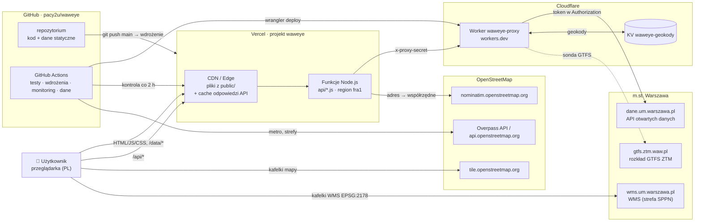

---

## 2. Komponenty i ich lokalizacja

| Komponent | Gdzie działa | Technologia | Kod | Rola |
|---|---|---|---|---|
| **Front (mapa)** | przeglądarka użytkownika | HTML + JS bez bundlera, Leaflet 1.9.4 (lokalnie w `public/vendor/`) | `public/index.html`, `public/app.js`, `public/trasa.js`, `public/pl2000.js`, `public/style.css` | rysowanie mapy i warstw, odpytywanie `/api/*`, wybór pojazdu, lokalizacja użytkownika |
| **Strona „O serwisie”** | przeglądarka | statyczny HTML, czcionki systemowe | `public/o-serwisie.html`, `public/media/` | opis produktu, film i zrzuty ekranu |
| **Pliki statyczne i dane warstw** | Vercel CDN (sieć brzegowa, globalnie) | pliki | `public/data/metro.geojson`, `public/data/strefa-czystego-transportu.geojson`, `public/data/trasy/*.json` (318 plików) | warstwy, które nie zmieniają się na żywo |
| **Funkcje API** | Vercel Functions, region **fra1** (Frankfurt), Node.js, limit 60 s | CommonJS, bez zależności produkcyjnych | `api/*.js` → `lib/handler.js` → `lib/warsaw.js`, `lib/geocoding.js` | jedyne miejsce, które łączy się z danymi miasta; normalizacja, cache, geokodowanie |
| **Pośrednik (Worker)** | Cloudflare Workers, adres `waweye-proxy.<konto>.workers.dev`, uruchamiany w centrum danych najbliższym wywołującemu (dla Vercel fra1 – Europa) | moduł ES | `worker/index.js`, `worker/wrangler.toml` | trzyma token API miasta, przekazuje zapytania, obsługuje magazyn geokodów i sondę GTFS |
| **Magazyn geokodów** | Cloudflare Workers KV, przestrzeń `waweye-geokody` (powiązanie `GEOKODY`) | klucz–wartość | obsługa w `worker/index.js`, klient `workerStore` w `lib/geocoding.js` | trwała pamięć „adres → współrzędne” wspólna dla wszystkich instancji Vercel |
| **Serwer lokalny** | komputer dewelopera | `node dev-server.js` | `dev-server.js`, `lib/mock.js` | to samo API co Vercel, tryb `MOCK=1` bez klucza |
| **Skrypty danych** | GitHub Actions (`ubuntu-latest`, Node 22) albo lokalnie | Node.js | `scripts/metro.js`, `scripts/strefy.js`, `scripts/trasy.js` | budowanie plików w `public/data/` |
| **Skrypty operacyjne** | GitHub Actions | Node.js, API Vercel i Cloudflare | `scripts/vercel-ops.js`, `scripts/cloudflare-ops.js`, `scripts/check-production.js` | zmiany konfiguracji bez panelu, monitoring |
| **Testy** | GitHub Actions, lokalnie | `node --test`, Playwright (Chromium) | `test/*.test.js`, `test/e2e.js` | testy jednostkowe i przeglądarkowe na danych MOCK |
| **Film promocyjny** | lokalnie (poza wdrożeniem, `.vercelignore`) | Chromium + ffmpeg | `wideo-promocyjne/` | generowanie 30-sekundowego filmu z prawdziwych danych |

### Źródła danych zewnętrznych

| Źródło | Adres | Kto pyta | Co daje | Licencja / zasady |
|---|---|---|---|---|
| Lokalizacja pojazdów ZTM | `dane.um.warszawa.pl/api/action/get_ztm_lokalizacja_pojazdow` (`{"type":1\|2}`) | Worker | pozycje autobusów i tramwajów | otwarte dane m.st. Warszawy, token |
| Pojazdy transportu publicznego | `…/get_ztm_pojazdy` | Worker | tabor: model, rocznik, zajezdnia… | j.w. |
| Wolne miejsca parkingowe | `…/get_m_parkingi_wolne_miejsca` | Worker | parkingi i wolne miejsca | j.w. |
| Utrudnienia drogowe | `…/get_bin_utrudnienia_drogowe` | Worker | punkty i odcinki utrudnień | j.w. |
| Zajęcia sportowe | `…/get_bmm_zajecia_sportowe` | Worker | kalendarz sport.um.warszawa.pl | j.w. |
| Kalendarz wydarzeń | `…/get_bmm_kalendarz_wydarzen` | Worker | wydarzenia um.warszawa.pl | j.w. |
| WMS miasta | `wms.um.warszawa.pl/serwis` (warstwa `KOMUNIKACJA_STREFA_PLATNEGO_PARKOWANIA`) | przeglądarka | kafelki strefy SPPN (EPSG:2178) | serwis publiczny |
| GTFS ZTM | `gtfs.ztm.waw.pl/last` | właściciel (przeglądarka), sonda Workera | trasy i przystanki linii | zasady ZTM: przetwarzanie dozwolone, dane muszą być aktualne |
| Kafelki OSM | `tile.openstreetmap.org` | przeglądarka | podkład mapy | ODbL, atrybucja na mapie |
| Nominatim | `nominatim.openstreetmap.org/search` | funkcje Vercel | współrzędne adresów zajęć i wydarzeń | maks. 1 zapytanie/s, identyfikujący User-Agent, cache |
| Overpass / OSM API | `overpass-api.de` i mirrory, `api.openstreetmap.org` | GitHub Actions | linie i stacje metra, granica SCT | ODbL |

---

## 3. Kod w repozytorium

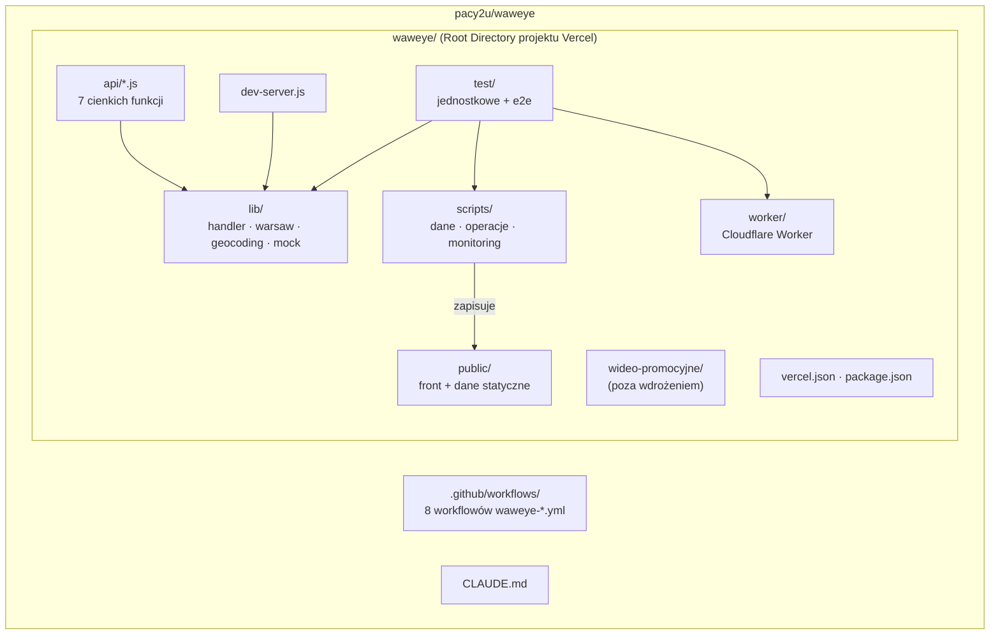

### Warstwy po stronie serwera

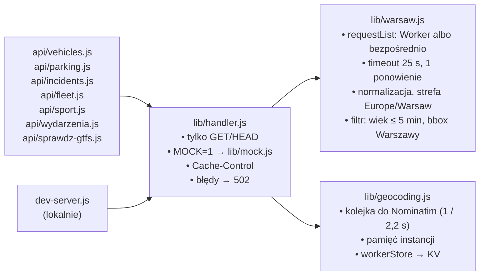

Każda funkcja w `api/` to trzy linie, które wołają handler z `lib/handler.js`. Te same handlery obsługuje `dev-server.js`, więc lokalnie i na Vercel działa ten sam kod.

### Endpointy API aplikacji

| Endpoint | Zasób Workera | Cache CDN (`s-maxage` / `stale-while-revalidate`) | Odświeżanie w przeglądarce |
|---|---|---|---|
| `GET /api/vehicles?types=1,2` | `?type=1`, `?type=2` (równolegle) | 5 s / 10 s | co 10 s, z animacją ruchu |
| `GET /api/parking` | `?resource=parking` | 30 s / 60 s | co 60 s, gdy warstwa włączona |
| `GET /api/incidents` | `?resource=incidents` | 60 s / 120 s | co 60 s, gdy warstwa włączona |
| `GET /api/fleet` | `?resource=fleet` | 1 h / 24 h | raz na sesję, po pierwszym kliknięciu pojazdu |
| `GET /api/sport` | `?resource=sport` + `?resource=geokody` | 30 min / 1 h; 15 s, gdy `pending > 0` | co 30 min (po 20 s, gdy trwa geokodowanie) |
| `GET /api/wydarzenia` | `?resource=wydarzenia` + `?resource=geokody` | j.w. | j.w. |
| `GET /api/sprawdz-gtfs` | `?resource=gtfs&probe=1` | bez cache | diagnostyka, ręcznie |

Odświeżanie zatrzymuje się w ukrytej karcie przeglądarki i wraca od razu po jej pokazaniu.

### Front

`public/app.js` (jeden plik IIFE) zawiera wszystkie warstwy mapy. Ważne zasady:

- **Jeden canvas Leaflet** dla pojazdów, tras, metra, linii utrudnień, SCT i okręgu dokładności lokalizacji. Drugi canvas leżałby nad pierwszym i połykał kliknięcia (test e2e pilnuje, że pojazdy są klikalne przy włączonych utrudnieniach).
- Osobny panel Leaflet `zones` pod pojazdami na kafelki WMS strefy SPPN; granicę rysuje filtr SVG `#sppn-edge` z `index.html`.
- `public/trasa.js` – wybór wariantu trasy (kierunku) z ostatnich pozycji pojazdu; `public/prognoza.js` – prognoza ruchu do timelapse (pojazdy po trasach linii ze średnią prędkością, liczba kursów w każdej godzinie z rozkładu GTFS z `/api/trasa?dzien=`); `public/pl2000.js` – przeliczenie WGS84 → PL-2000 strefa 7 (EPSG:2178) dla zapytań WMS.
- Preferencje warstw w `localStorage` (`waweye.strefy`, `waweye.metro`). Pozycja użytkownika (Geolocation API) nie opuszcza przeglądarki.
- Panele szczegółów (pojazd, parking, utrudnienie, sport, wydarzenie, strefa, stacja metra) wzajemnie się wykluczają.

---

## 4. Przepływy danych na żywo

### 4.1. Pojazdy (co 10 s)

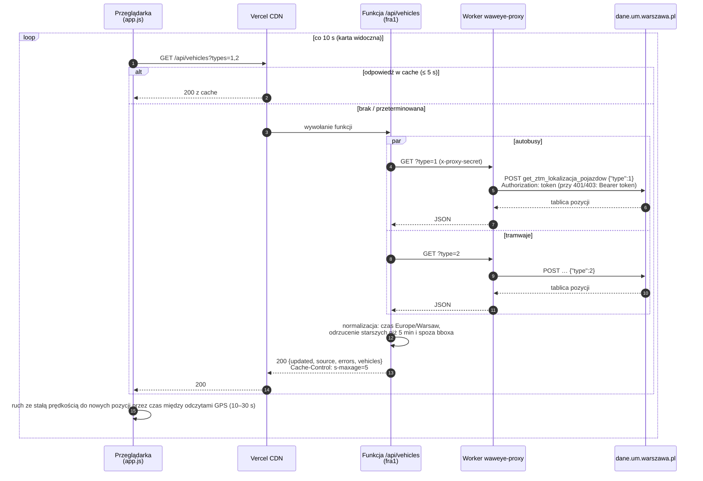

Jeśli jeden typ (np. tramwaje) się nie pobierze, odpowiedź zawiera drugi i listę `errors`; pasek statusu informuje o częściowych danych.

### 4.2. Kliknięcie pojazdu: tabor i trasa linii

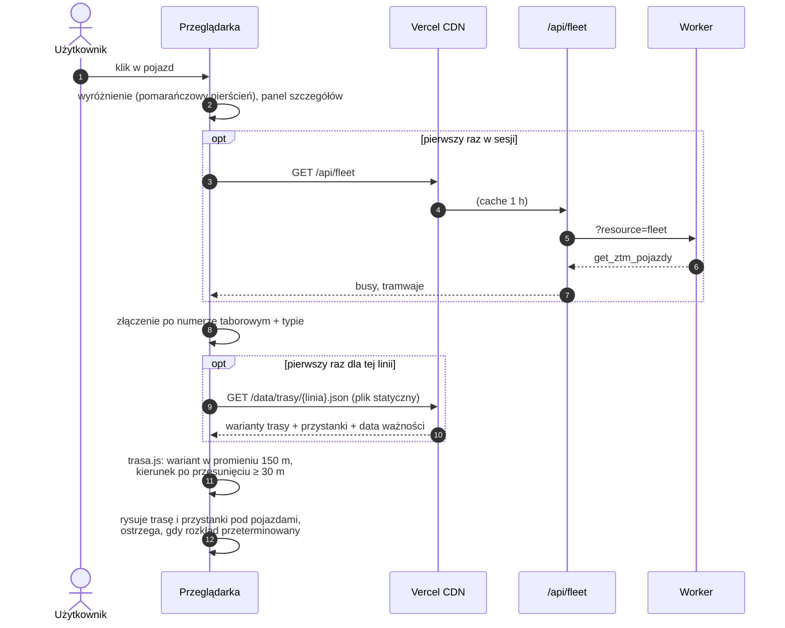

### 4.3. Sport i DziejeSię z geokodowaniem

Część rekordów nie ma współrzędnych, tylko adres. Funkcja szuka ich w magazynie KV, a resztę w Nominatim – w limicie czasu odpowiedzi, a potem dalej w tle.

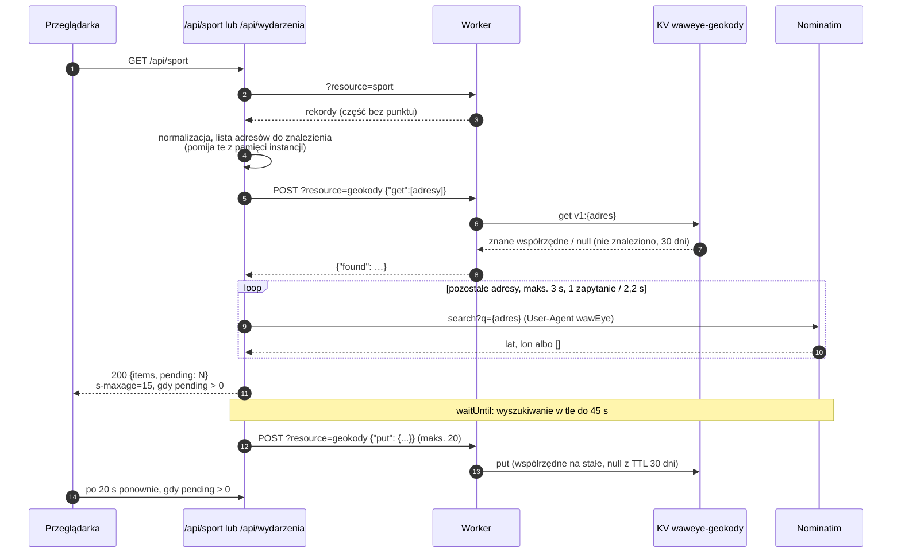

Zabezpieczenia: odpowiedź 429/403 z Nominatim wstrzymuje wyszukiwanie na 10 min; gdy magazyn KV nie odpowiada, funkcja działa bez niego i próbuje ponownie po 10 min. `/api/sport` i `/api/wydarzenia` to osobne funkcje z osobnymi kolejkami, więc razem pytają Nominatim rzadziej niż raz na sekundę.

### 4.4. Warstwy pobierane wprost przez przeglądarkę

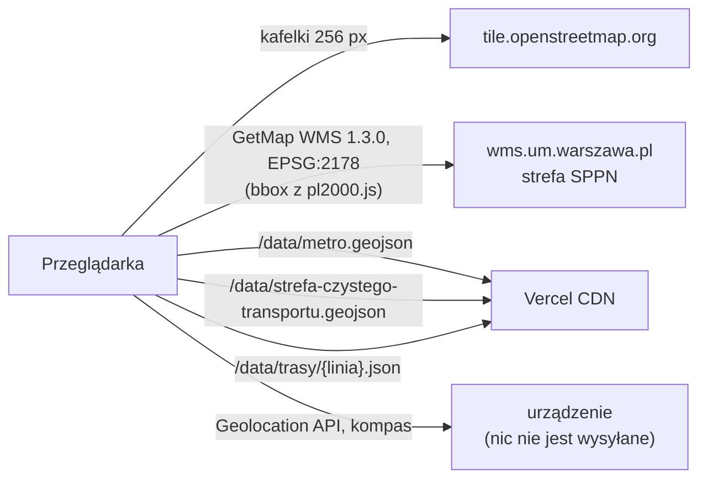

WMS miasta odpowiada przeglądarkom w Polsce, ale nie serwerom w chmurze, dlatego jest pobierany bezpośrednio z przeglądarki. Filtr SVG granicy nie czyta pikseli, więc nie potrzebuje CORS.

---

## 5. Dane statyczne i ich odświeżanie

| Plik | Skrypt | Źródło | Jak odświeżany | Kontrola przed zapisem |
|---|---|---|---|---|
| `public/data/metro.geojson` | `scripts/metro.js` | Overpass (relacje `route=subway` M1, M2) | workflow **wawEye – dane metra** (ręcznie albo po zmianie skryptu na gałęzi innej niż `main`), sam commituje | 2 linie, M1 = 21 i M2 = 18 stacji, Centrum i Świętokrzyska w Śródmieściu, wszystko w granicy Warszawy |
| `public/data/strefa-czystego-transportu.geojson` | `scripts/strefy.js` | Overpass (relacja 17792822), zapasowo api.openstreetmap.org | workflow **wawEye – dane stref**, j.w. | powierzchnia 25–60 km², PKiN w środku, Wilanów poza |
| `public/data/trasy/<linia>.json`, `index.json` | `scripts/trasy.js <folder GTFS>` | GTFS ZTM | **ręcznie**: właściciel pobiera ZIP w przeglądarce, skrypt uruchamiany w sesji, wynik commitowany | ≥ 250 linii, obecne 175, 17, N25, przystanki i położenie w Warszawie |

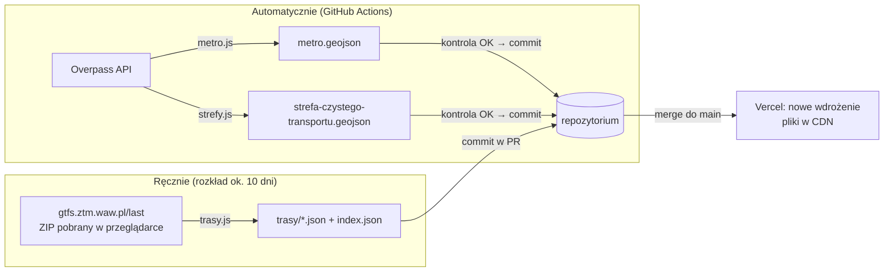

Rozkład GTFS obejmuje ok. 10 dni, a zasady ZTM wymagają aktualnych danych, więc trasy trzeba odświeżać co tydzień. Sonda `?resource=gtfs` w Workerze i `/api/sprawdz-gtfs` sprawdzają, czy GTFS da się pobierać automatycznie (ROADMAPA, Faza 1).

---

## 6. Infrastruktura

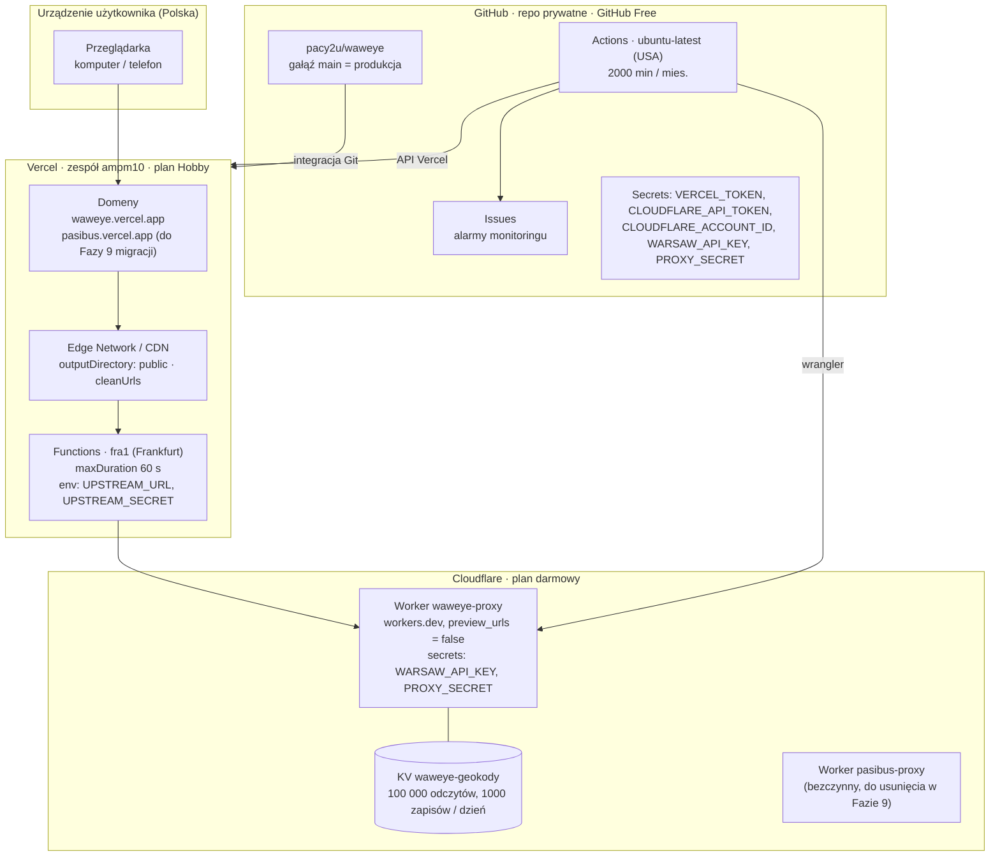

| Usługa | Plan / koszt | Konfiguracja w repo | Uwagi |
|---|---|---|---|
| Vercel | Hobby, 0 zł | `waweye/vercel.json` (`regions: ["fra1"]`, `cleanUrls`, `maxDuration 60`), `.vercelignore` | Root Directory projektu: `waweye`. Wdrożenie produkcyjne z `main`, podglądy z gałęzi/PR |
| Cloudflare Workers | darmowy | `waweye/worker/wrangler.toml` (`keep_vars = true`, `preview_urls = false`) | powiązanie KV dopisuje workflow wdrożenia tylko w swoim checkoucie |
| Cloudflare KV | darmowy | — | przestrzeń tworzy `cloudflare-ops.js podepnij-kv` |
| GitHub Actions | 2000 min / mies. (repo prywatne) | `.github/workflows/waweye-*.yml` | monitoring ok. 360 min / mies.; po wyczerpaniu puli zadania stają, bez kosztów |
| OpenStreetMap | bezpłatnie, zasady użycia | — | kafelki, Nominatim, Overpass |
| Dane m.st. Warszawy | bezpłatnie, token | — | token z dane.um.warszawa.pl/key-api, tylko w sekretach |

### Tryby działania funkcji

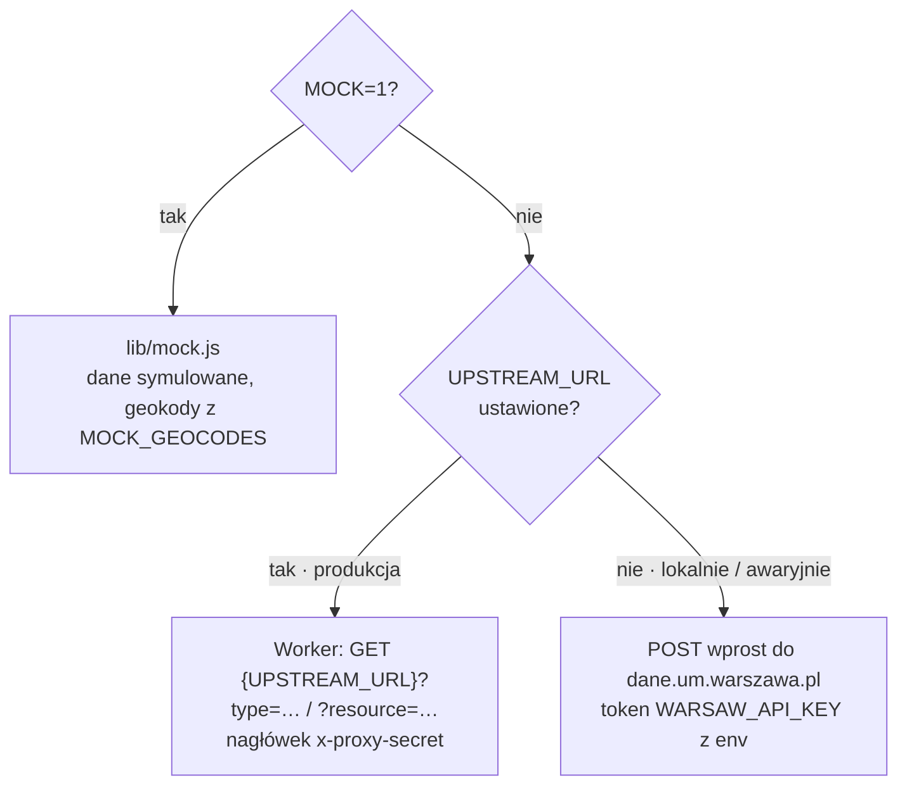

---

## 7. CI/CD i operacje

### 7.1. Od zmiany do produkcji

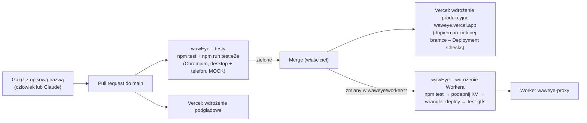

Zmiany samych plików `.md` nie uruchamiają testów (oszczędność minut).

### 7.2. Workflowy

| Workflow | Plik | Wyzwalacz | Co robi |
|---|---|---|---|
| wawEye – testy | `waweye-testy.yml` | PR, push do `main` (zmiany w `waweye/**` poza `.md`), ręcznie | testy jednostkowe i e2e, zrzuty ekranu jako artefakt |
| wawEye – wdrożenie Workera Cloudflare | `waweye-wdrozenie-workera.yml` | push do `main` w `waweye/worker/**`, ręcznie | testy, KV `waweye-geokody`, `wrangler deploy`, sonda GTFS |
| wawEye – monitoring produkcji | `waweye-monitoring-produkcji.yml` | cron `7 */2 * * *` (co 2 h), ręcznie | `check-production.js` na obu domenach, zgłoszenie przy awarii |
| wawEye – kontrola adresu | `waweye-kontrola-adresu.yml` | ręcznie | `check-production.js` dla dowolnego adresu, bez zgłoszeń |
| wawEye – operacje Vercel | `waweye-operacje-vercel.yml` | ręcznie | `stan`, domeny, przekierowania, przełączanie Workera, Root Directory, wdrożenie produkcji + kontrola |
| wawEye – operacje Cloudflare | `waweye-operacje-cloudflare.yml` | ręcznie | `stan`, `test-workera`, `test-gtfs`, `ustaw-sekrety`, `usun-workera` (z blokadami) |
| wawEye – dane metra (M1, M2) | `waweye-dane-metra.yml` | ręcznie, push skryptu poza `main` | buduje i commituje `metro.geojson` |
| wawEye – dane stref (SCT, SPPN) | `waweye-dane-stref.yml` | ręcznie, push skryptu poza `main` | buduje i commituje granicę SCT |

### 7.3. Operacje bez panelu

Konfigurację Vercel i Cloudflare zmieniają workflowy uruchamiane ręcznie. Aplikacja Claude na GitHubie nie może ich uruchamiać, więc podział ról wygląda tak:

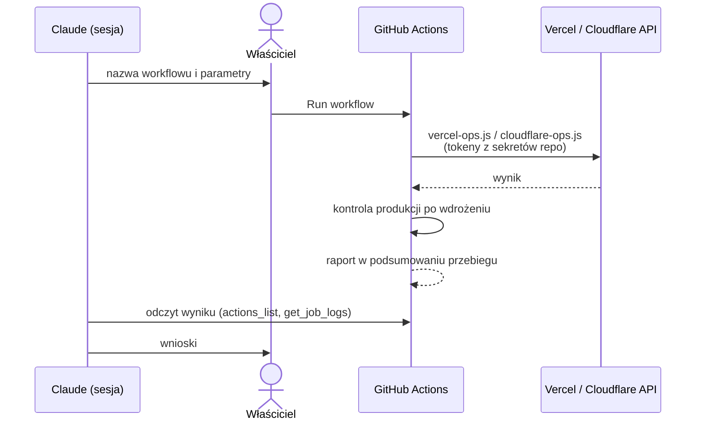

---

## 8. Monitoring

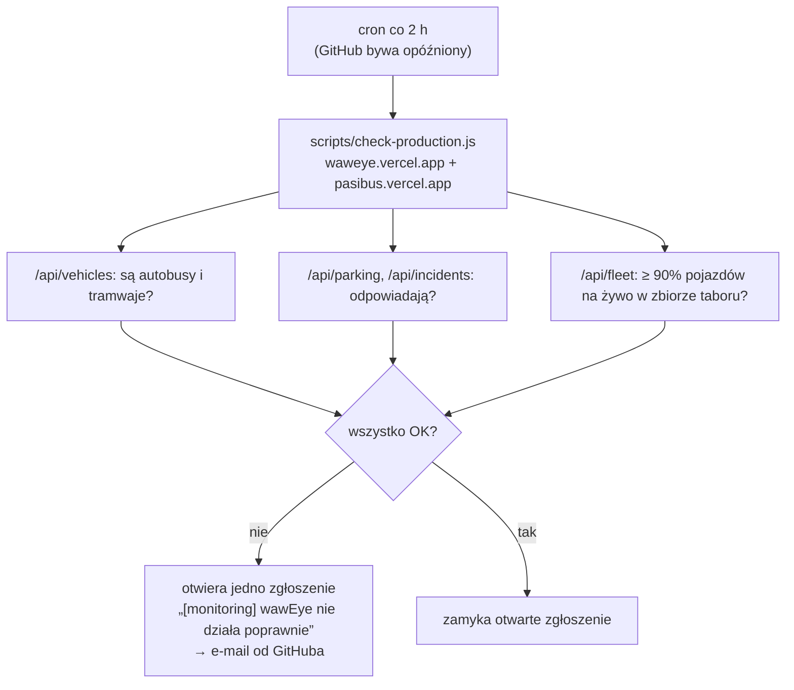

**Zewnętrzny monitor (od 2026-10-12):** UptimeRobot (konto właściciela) co 5 min sprawdza `https://waweye.vercel.app/api/vehicles` i alarmuje e-mailem, gdy odpowiedź nie zawiera `"source":"live"`. Uzupełnia monitoring w Actions, który przez opóźnienia harmonogramów GitHuba działa średnio co kilka godzin. Każdy błąd w raporcie monitoringu Actions ma kategorię **dostawca** albo **aplikacja**, a błąd samego dostawcy jest sprawdzany ponownie po 4 min.

Dodatkowe sygnały: pasek statusu w aplikacji pokazuje błędy częściowe (`errors`) i wiek danych; `test-workera` w operacjach Cloudflare sprawdza wszystkie zasoby Workera i odmowę 403 bez sekretu. Aplikacja nie zbiera analityki użytkowników – mierzone jest tylko działanie techniczne.

---

## 9. Bezpieczeństwo i sekrety

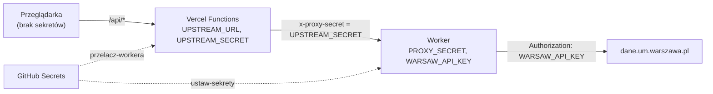

| Gdzie | Nazwa | Przeznaczenie |
|---|---|---|
| Cloudflare Worker (Secret) | `WARSAW_API_KEY` | token API miasta; jedyne miejsce w produkcji, gdzie jest używany |
| Cloudflare Worker (Secret) | `PROXY_SECRET` | wspólny sekret Vercel ↔ Worker; bez niego Worker odpowiada 403 |
| Cloudflare Worker (KV) | `GEOKODY` | powiązanie z przestrzenią `waweye-geokody` (identyfikator nie jest sekretem) |
| Vercel (Production, *sensitive*) | `UPSTREAM_URL`, `UPSTREAM_SECRET` | adres Workera i ten sam sekret co `PROXY_SECRET` |
| GitHub Secrets | `VERCEL_TOKEN`, `CLOUDFLARE_API_TOKEN`, `CLOUDFLARE_ACCOUNT_ID`, `WARSAW_API_KEY`, `PROXY_SECRET` | workflowy wdrożeń, operacji i testów Workera |
| Lokalnie | `waweye/.env` (w `.gitignore`) | `WARSAW_API_KEY` dla `npm start` |

Zasady:
- Token API nigdy nie trafia do przeglądarki ani do repozytorium.
- API aplikacji jest tylko do odczytu: inne metody niż GET/HEAD dostają 405.
- Worker przyjmuje do magazynu geokodów tylko współrzędne w granicach Warszawy (bbox 51,9–52,6 N, 20,5–21,6 E), maks. 20 wpisów na zapis i 100 na odczyt.
- `usun-workera` odmawia, jeśli Worker jest celem wdrożeń, używa go produkcja albo miał ruch w ostatnich 7 dniach.
- Pozycja użytkownika i preferencje warstw zostają w przeglądarce; brak ciasteczek i analityki.

---

## 10. Ograniczenia sieciowe

To one wyjaśniają, dlaczego architektura ma pośrednika i dlaczego część danych pobiera przeglądarka albo człowiek.

| Skąd → dokąd | dane.um.warszawa.pl | wms.um.warszawa.pl | gtfs.ztm.waw.pl | Nominatim / Overpass |
|---|---|---|---|---|
| Przeglądarka w Polsce | działa, ale **brak CORS** | ✅ | ✅ (ręczne pobranie) | — |
| Vercel fra1 (bezpośrednio) | ❌ `UND_ERR_CONNECT_TIMEOUT` | — | sprawdza `/api/sprawdz-gtfs` | ✅ Nominatim |
| Worker wołany z Vercel fra1 | ✅ | — | sprawdza sonda | — |
| Worker wołany z GitHub Actions (USA) | ❌ 522 | — | sprawdza `test-gtfs` | — |
| GitHub Actions | ❌ | ❌ | ❌ przekroczony czas | ✅ Overpass |

Wnioski dla architektury:
1. **Worker jako pośrednik** – Cloudflare uruchamia go blisko wywołującego, więc zapytanie z Vercel fra1 wychodzi z europejskiego centrum danych, które API miasta przyjmuje.
2. **Nowego Workera testuje się przez podgląd Vercel** (`operacje Vercel → przelacz-podglady`), a nie z Actions.
3. **WMS i kafelki pobiera przeglądarka**, bo serwery w chmurze nie dostają odpowiedzi.
4. **GTFS pobiera człowiek** – do czasu znalezienia drogi automatycznej.

---

## 11. Decyzje architektoniczne

| Decyzja | Powód |
|---|---|
| Front bez bundlera i frameworka, Leaflet w `public/vendor/` | prostota, brak kroku budowania, brak zależności od zewnętrznych CDN |
| Funkcje bezstanowe + cache CDN (`s-maxage`) | wielu użytkowników nie zwiększa liczby zapytań do API miasta; zmieści się w planie Hobby |
| Region `fra1` | najbliżej Warszawy; Worker wołany stąd jest przyjmowany przez API miasta |
| Cloudflare Worker jako pośrednik i strażnik tokenu | API miasta odrzuca adresy Vercel/AWS, a przeglądarka nie może pytać wprost (brak CORS) |
| KV dla geokodów zamiast bazy danych | trwała pamięć wspólna dla instancji, za 0 zł, w tym samym miejscu co Worker |
| Nominatim tylko z serwera, z kolejką i cache | zgodność z zasadami OSM (≤ 1 zapytanie/s), jeden wynik dla wszystkich użytkowników |
| Dane rzadko zmienne jako pliki w repo, budowane skryptami z kontrolą | brak zapytań na żywo do wolnych/niedostępnych źródeł, historia zmian w git, zła odpowiedź nie nadpisze pliku |
| Tylko oficjalne zbiory miasta dla rozkładów i tras (metro z OSM, bo miasto go nie publikuje) | wiarygodność danych dla codziennych pasażerów |
| Jeden canvas dla warstw wektorowych | drugi canvas przechwytywał kliknięcia pojazdów |
| Operacje infrastrukturalne jako workflowy z tokenami w sekretach | brak CLI u właściciela, powtarzalność, ślad w historii przebiegów |
| Budżet 0 zł, brak analityki | decyzje produktowe z 2026-10-02 (`ROADMAPA.md`) |
