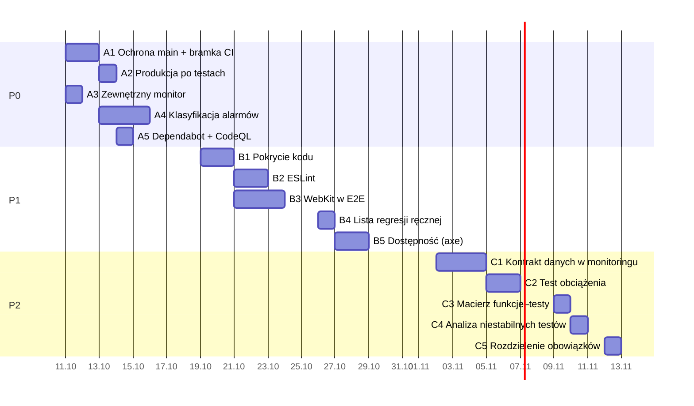

# wawEye – plan naprawczy testów

Plan usunięcia luk opisanych w `TESTY_I_JAKOSC.md` §11. Każde zadanie ma lukę źródłową, działanie, mierzalne kryterium odbioru, osobę odpowiedzialną i szacunek pracy. Stan na 2026-10-11.

Ocena pewności jak w raporcie: **[Pewne]**, **[Prawdopodobne]**, **[Niezweryfikowane]**, **[Szacunek]**. Wszystkie godziny w tym planie to [Szacunek] dla jednej osoby bez AI.

## Spis treści

1. [Nowe ustalenie: przyczyny alarmów monitoringu](#1-nowe-ustalenie-przyczyny-alarmów-monitoringu)
2. [Priorytety i harmonogram](#2-priorytety-i-harmonogram)
3. [Etap 1 – P0: ustawienia i monitoring (tydzień 1)](#3-etap-1--p0-ustawienia-i-monitoring-tydzień-1)
4. [Etap 2 – P1: narzędzia jakości i przeglądarki (tygodnie 2–3)](#4-etap-2--p1-narzędzia-jakości-i-przeglądarki-tygodnie-23)
5. [Etap 3 – P2: kontrakt, wydajność, ślad audytowy (tygodnie 4–6)](#5-etap-3--p2-kontrakt-wydajność-ślad-audytowy-tygodnie-46)
6. [Mierniki sukcesu](#6-mierniki-sukcesu)
7. [Ryzyka planu](#7-ryzyka-planu)
8. [Czego świadomie nie robimy](#8-czego-świadomie-nie-robimy)
9. [Nadzór nad realizacją](#9-nadzór-nad-realizacją)

---

## 1. Nowe ustalenie: przyczyny alarmów monitoringu

Raport mówił, że przyczyny 8 czerwonych przebiegów nie są opisane. Przy przygotowaniu planu przeczytałem treść wszystkich pięciu zgłoszeń z tego okresu (#36, #37, #61, #64, #67; pozostałe 3 czerwone przebiegi trafiły na już otwarte zgłoszenie).

| Zgłoszenie | Data | Co padło na `waweye.vercel.app` | `pasibus.vercel.app` chwilę później |
|---|---|---|---|
| #36 | 2026-10-04 17:19 | tabor: HTTP 502 (HTTP 522) | wszystko OK |
| #37 | 2026-10-05 07:28 | pojazdy (autobusy) i parkingi: HTTP 522 | wszystko OK |
| #61 | 2026-10-07 19:25 | pojazdy (tramwaje): HTTP 522 | wszystko OK |
| #64 | 2026-10-09 02:18 | utrudnienia i tabor: HTTP 522 | wszystko OK |
| #67 | 2026-10-10 07:42 | pojazdy (tramwaje) i utrudnienia: HTTP 522 | wszystko OK |

Wnioski:

- **Wszystkie 5 alarmów to ten sam objaw:** API Warszawy odpowiada Workerowi Cloudflare błędem 522 (przekroczony czas połączenia) dla części zbiorów. Nigdy nie padła cała aplikacja. [Pewne]
- **Oba adresy to to samo wdrożenie Vercel** (jeden projekt, dwie domeny). `pasibus.vercel.app` jest sprawdzany po `waweye.vercel.app`, czyli po jego 30-sekundowym ponowieniu, i zawsze przechodził. Awaria trwa więc od ok. 30 s do kilku minut. [Pewne] co do kolejności, [Prawdopodobne] co do czasu trwania.
- **Przyczyna leży u dostawcy danych albo na łączu Cloudflare ↔ serwery miasta**, nie w kodzie wawEye. Pasuje to do znanego problemu: serwery miasta odrzucają część lokalizacji Cloudflare (`ARCHITEKTURA.md` §10). [Prawdopodobne]
- **Skutek dla użytkownika jest realny, ale częściowy:** przez kilka minut brakuje jednej warstwy, a pasek statusu pokazuje „brak danych”. [Pewne]

Monitoring działa więc poprawnie, ale nie odróżnia krótkiej awarii dostawcy od awarii aplikacji, a każde zgłoszenie wygląda tak samo. Na tym opiera się zadanie A4.

---

## 2. Priorytety i harmonogram

**Stan realizacji (2026-10-25):**
- **P0 – zamknięte.** A1: bramka CI w kodzie; reguła gałęzi zapisana, lecz nieegzekwowana (repozytorium jest od 2026-10 publiczne, więc egzekwowanie i CodeQL są już dostępne – do włączenia przez właściciela). A2: Vercel Deployment Checks czekają na `bramka`, a workflow testów uruchamia się przy każdym pushu do `main` (PR #78). A3: UptimeRobot co 5 min, alarm przetestowany. A4: **odebrane 2026-10-25** (wynik niżej). A5: Dependabot włączony; CodeQL do włączenia po upublicznieniu.
- **Odbiór A4 (2026-10-12 – 2026-10-25):** 59 przebiegów monitoringu, 52 udane (88%). 7 zgłoszeń `[monitoring]` (#88, #89, #92, #94, #95, #96, #98), **każde z etykietą przyczyny**, każde zamknięte z komentarzem o czasie otwarcia (#98 jeszcze otwarte). 6 × `monitoring:dostawca` (wszystkie: HTTP 522 z Cloudflare **FRA**), 1 × `monitoring:aplikacja` (#95). Wnioski: (1) hipoteza o odrzucanych lokalizacjach Cloudflare obalona – 522 występuje w tej samej lokalizacji, w której aplikacja zwykle działa, więc to przerwy po stronie API miasta [Prawdopodobne]; następny krok: zgłoszenie do operatora API. (2) #95 to błędna kategoria: API zwróciło 189 rekordów, ale wszystkie starsze niż 5 min (filtr `MAX_AGE_MS`), więc 0 pojazdów – to przestarzałe dane dostawcy, nie błąd aplikacji [Prawdopodobne]. Do poprawy w `check-production.js`: „0 pojazdów przy rekordach od API” → kategoria dostawca z ponowną kontrolą.
- **P1 – zrobione w kodzie** (PR #76, #77): B1 pokrycie, B2 ESLint, B3 WebKit przechodzi w całości (informacyjnie). Obserwacja 2026-10-12 – 2026-10-25: na `main` 4/4 zielone; w PR 11 przebiegów, 4 czerwone, z czego 3 czerwone też w Chromium (prawdziwe błędy PR) i **1 niestabilny test tylko w WebKit** (kompas na telefonie, 2026-10-13: po `alpha 0` wiązka została na `rotate(90deg)`). Przestawienie na wymagany dopiero po uodpornieniu tego testu, B4 lista regresji i szablon PR, B5 axe bez wyjątków.
- **Decyzje właściciela (2026-10-11):** przyciski „O serwisie” w wariancie B; poziom WCAG zaparkowany; bez prośby o czujniki ruchu na iOS; reguła `main` bez egzekwowania. Otwarte: formater (B2).

| Priorytet | Kiedy | Zadania | Praca [Szacunek] | Charakter |
|---|---|---|---|---|
| **P0** | tydzień 1 | A1–A5 | 11–19 h | głównie ustawienia; zamyka luki, które audytor uzna za kontrolne |
| **P1** | tygodnie 2–3 | B1–B5 | 29–44 h | nowe narzędzia w CI, druga przeglądarka, lista regresji ręcznej |
| **P2** | tygodnie 4–6 | C1–C5 | 20–34 h | kontrakt z API, wydajność, ślad audytowy |
| **Razem** | 6 tygodni | 15 zadań | **60–97 h** (ok. 8–12 dni pracy) | |

Odpowiedzialni: **Właściciel** – ustawienia GitHuba, Vercel, kont zewnętrznych (Claude nie ma do nich dostępu); **Zespół** – zmiany w kodzie i workflowach przez PR (może je przygotować Claude).

---

## 3. Etap 1 – P0: ustawienia i monitoring (tydzień 1)

### A1. Ochrona gałęzi `main` i bramka CI

- **Luki:** #3 (produkcja nie czeka na testy), #4 (ochrona gałęzi nieznana), #13 (jedna osoba).
- **Działanie:**
  1. Właściciel sprawdza w **Settings → Branches / Rulesets**, czy `main` ma ochronę, i zapisuje stan w tym pliku (dziś [Niezweryfikowane]).
  2. Zespół dodaje do `waweye-testy.yml` zadanie-bramkę, które **uruchamia się przy każdym PR**. Gdy zmieniły się tylko pliki `.md`, kończy się od razu na zielono, a w innym przypadku czeka na wynik testów. Bez tego wymagany check nigdy nie zgłosi wyniku dla PR z samą dokumentacją i taki PR utknie na „Expected – waiting for status”: filtr `paths` pomija cały workflow. [Pewne – zachowanie GitHuba przy pominiętych workflowach]
  3. Właściciel włącza regułę: wymagany check bramki, „Require branches to be up to date before merging”, zakaz force-push i usuwania `main`.
- **Kryterium odbioru:** próbny PR z celowo zepsutym testem nie daje się scalić; PR z samym plikiem `.md` daje się scalić; zrzut lub eksport reguły dołączony do tego pliku.
- **Praca:** 2–4 h (bramka 1–3 h, ustawienia 15 min).
- **Odpowiedzialni:** Zespół (bramka), Właściciel (reguła).

### A2. Produkcja Vercel dopiero po zielonych testach

- **Luka:** #3.
- **Działanie:** po A1 każda zmiana na `main` jest aktualna względem `main` i zielona przed scaleniem, więc ryzyko maleje do zmian wpływających na `main` równolegle. Dodatkowo sprawdzić, czy plan Vercel oferuje blokadę promocji na produkcję do czasu zielonych checków GitHuba (funkcja „Deployment Checks”) [Niezweryfikowane]. Jeśli tak – włączyć dla checku bramki z A1.
- **Kryterium odbioru:** opisana decyzja: włączona blokada w Vercel albo uzasadnienie, że A1 wystarcza.
- **Praca:** 1–2 h.
- **Odpowiedzialny:** Właściciel.

### A3. Zewnętrzny monitor dostępności

- **Luka:** #1 (harmonogram Actions „co 2 h” działa średnio co 6,5 h).
- **Działanie:** darmowy zewnętrzny monitor HTTP (np. UptimeRobot; darmowy plan sprawdza co 5 min [Prawdopodobne]) na `https://waweye.vercel.app/api/vehicles` z warunkiem: kod 200 i treść zawiera `"source":"live"`. Powiadomienie e-mailem do właściciela. Monitoring w Actions zostaje do pełnej kontroli (tabor, trasy), ale nie jest już jedynym kanałem.
- **Kryterium odbioru:** monitor aktywny; próbny alarm (np. chwilowo zła ścieżka) dotarł e-mailem; adres i dane konta zapisane w `ARCHITEKTURA.md` §8 (bez haseł).
- **Praca:** 1 h.
- **Odpowiedzialny:** Właściciel (konto zewnętrzne).
- **Uwaga:** 288 dodatkowych zapytań dziennie do `/api/vehicles` przechodzi do API miasta. Przy obecnym ruchu to nieistotne obciążenie, ale warto to odnotować. [Prawdopodobne]

### A4. Klasyfikacja i obsługa alarmów monitoringu

- **Luka:** #2 (czerwone przebiegi bez opisanych przyczyn); ustalenia z §1.
- **Działanie (kod, `scripts/check-production.js` i workflow monitoringu):**
  1. Każdy błąd w raporcie dostaje kategorię: **dostawca danych** (522, timeout, błąd sieci w odpowiedzi API miasta przekazany przez Workera) albo **aplikacja** (5xx bez błędu dostawcy, źródło MOCK, pusta lista, zły format, nieświeże trasy).
  2. Zgłoszenie otwiera się od razu przy błędzie kategorii „aplikacja”. Błąd samego dostawcy jest sprawdzany ponownie **4 minuty później w tym samym przebiegu** i liczy się dopiero wtedy, gdy trwa; chwilowy trafia tylko do podsumowania przebiegu. (Pierwotnie: „dwa kolejne przebiegi”. Przy przebiegach co ok. 6,5 h potwierdzenie przychodziłoby po godzinach, a awarie z §1 trwały minuty, więc ponowna kontrola w przebiegu jest szybsza i dokładniejsza.)
  3. Zgłoszenie dostaje etykietę `monitoring:dostawca` albo `monitoring:aplikacja`. Komentarz przy automatycznym zamknięciu podaje czas trwania.
  4. Worker dodaje do odpowiedzi nagłówek z lokalizacją Cloudflare (`colo`), a raport go wypisuje. To potwierdzi albo obali hipotezę o odrzucanych lokalizacjach.
- **Kryterium odbioru:** testy jednostkowe `evaluate()` dla obu kategorii i reguły ponownej kontroli; przez 2 tygodnie po wdrożeniu 100% zgłoszeń ma etykietę przyczyny.
- **Praca:** 6–10 h.
- **Odpowiedzialny:** Zespół.

### A5. Skanowanie zależności i kodu

- **Luka:** #7.
- **Działanie:** plik `.github/dependabot.yml` dla `npm` (`/waweye`) i `github-actions` (`/`), raz w tygodniu; właściciel włącza **Code scanning → CodeQL → Default setup** dla JavaScript.
- **Kryterium odbioru:** pierwszy przebieg CodeQL zakończony, wyniki przejrzane (zero otwartych alertów wysokich albo zgłoszenia na każdy); Dependabot otworzył pierwszy PR albo potwierdził brak aktualizacji.
- **Praca:** 1–2 h.
- **Odpowiedzialni:** Zespół (plik), Właściciel (CodeQL).

---

## 4. Etap 2 – P1: narzędzia jakości i przeglądarki (tygodnie 2–3)

### B1. Pomiar pokrycia kodu

- **Luka:** #5.
- **Działanie:** `npm run test:coverage` z wbudowanym pomiarem Node 22 (`node --test --experimental-test-coverage`), wynik w podsumowaniu przebiegu CI. Najpierw pomiar bazowy; potem próg = wynik bazowy zaokrąglony w dół, osobno dla `lib/`, `worker/`, `scripts/`. Pliki z `public/` testowane w przeglądarce (np. `app.js`) mają w testach Node pokrycie bliskie zera, więc są wyłączone z progu i opisane jako pokryte przez E2E.
- **Kryterium odbioru:** raport pokrycia w każdym przebiegu; spadek poniżej progu kończy przebieg błędem; wynik bazowy zapisany w `TESTY_I_JAKOSC.md`.
- **Praca:** 4–6 h.
- **Odpowiedzialny:** Zespół.

### B2. Linter

- **Luka:** #6.
- **Działanie:** ESLint (konfiguracja płaska, reguły `recommended`, środowiska Node i przeglądarki) jako `npm run lint` i krok w CI przed testami. Najpierw naprawić błędy, ostrzeżenia zostawić jako dług. **Formatera (Prettier) nie włączamy bez decyzji właściciela:** przeformatowałby każdy plik i zaciemnił historię zmian.
- **Kryterium odbioru:** `npm run lint` bez błędów na `main`; krok lint w CI; decyzja o formaterze zapisana.
- **Praca:** 6–10 h (zależnie od liczby znalezionych błędów).
- **Odpowiedzialny:** Zespół.

### B3. Druga przeglądarka w E2E

- **Luka:** #9.
- **Działanie:** przebieg „mobile” w E2E uruchamiany także w WebKit (emulacja iPhone'a) przez Playwright; w CI instalacja WebKit z zależnościami (+1–2 min przebiegu). Firefox opcjonalnie później. WebKit na Linuksie nie jest identyczny z Safari na iOS, więc B4 nadal wymaga testu na prawdziwym urządzeniu.
- **Kryterium odbioru:** E2E zielone w Chromium i WebKit; różnice zachowania udokumentowane albo naprawione; czas przebiegu CI poniżej 10 min.
- **Praca:** 8–12 h (głównie poprawki różnic między przeglądarkami).
- **Odpowiedzialny:** Zespół.

### B4. Lista regresji ręcznej i szablon PR

- **Luki:** #9, #12.
- **Działanie:** plik `LISTA_REGRESJI_RECZNEJ.md` (ok. 15 punktów, 20–30 min): iPhone z Safari na prawdziwym urządzeniu, orientacja pozioma, wolna sieć (dławienie w DevTools), lokalizacja, każdy panel i warstwa raz. Szablon PR z polami: „testy lokalnie”, „lista regresji (tak / nie dotyczy)”, „ryzyko”.
- **Kryterium odbioru:** lista w repo; szablon PR używany; lista wykonana i odhaczona w PR przed każdą zmianą widoczną dla użytkownika.
- **Praca:** 3–4 h przygotowania, potem 20–30 min na wydanie.
- **Odpowiedzialni:** Zespół (pliki), autor PR (wykonanie).

### B5. Testy dostępności

- **Luka:** #10.
- **Działanie:** `axe-core` wstrzyknięty w E2E na widoku mapy i w każdym panelu; przebieg kończy się błędem przy naruszeniach „serious” i „critical”. Znana decyzja projektowa (znaczniki mapy niedostępne z klawiatury) trafia na jawną listę wyjątków z uzasadnieniem. Docelowy poziom WCAG decyduje właściciel.
- **Kryterium odbioru:** zero naruszeń „serious/critical” poza listą wyjątków; decyzja o poziomie WCAG zapisana w `CONTEXT.md`.
- **Praca:** 8–12 h (z poprawkami).
- **Odpowiedzialni:** Zespół, Właściciel (decyzja WCAG).

---

## 5. Etap 3 – P2: kontrakt, wydajność, ślad audytowy (tygodnie 4–6)

### C1. Kontrola kontraktu danych w monitoringu

- **Luka:** #8 (E2E tylko na MOCK; zmianę formatu API widać dopiero na produkcji).
- **Działanie:** testu kontraktowego z GitHub Actions nie da się uruchomić, bo API miasta odpowiada 522 na zapytania z USA. Rozwiązanie: `check-production.js` sprawdza nie tylko liczbę rekordów, ale też ich kształt (wymagane pola i typy po normalizacji, np. pojazd ma `line`, `lat`, `lon`, `type`, `vehicle`). Zmiana formatu po stronie miasta zostaje wykryta w ciągu jednego przebiegu monitoringu jako błąd kategorii „aplikacja”.
- **Kryterium odbioru:** test jednostkowy z rekordem o brakującym polu daje błąd; reguły dla 5 zasobów sprawdzanych przez monitoring.
- **Praca:** 6–10 h.
- **Odpowiedzialny:** Zespół.

### C2. Prosty test obciążenia

- **Luka:** #11.
- **Działanie:** jednorazowy pomiar na podglądzie Vercel (nie na produkcji): 10–20 zapytań/s przez 5 min na `/api/vehicles` i `/api/parking`; pomiar p95, błędów i zachowania pamięci podręcznej. **Każde zapytanie, którego nie obsłuży pamięć podręczna, trafia do API miasta**, więc test wymaga zgody właściciela i umiarkowanego ruchu.
- **Kryterium odbioru:** raport z p95 i odsetkiem błędów; wniosek, ilu jednoczesnych użytkowników obsłuży obecna konfiguracja.
- **Praca:** 6–10 h.
- **Odpowiedzialni:** Zespół, Właściciel (zgoda).

### C3. Macierz funkcje–testy

- **Luka:** #12.
- **Działanie:** tabela 11 funkcji użytkownika (z `PIERWSZE_KROKI.md`) → testy jednostkowe i kroki E2E, które je pokrywają, generowana skryptem z nazw kroków `test/e2e.js` i `test(...)`, żeby się nie dezaktualizowała.
- **Kryterium odbioru:** macierz w `TESTY_I_JAKOSC.md`; każda funkcja ma co najmniej jeden krok E2E i jeden scenariusz awarii.
- **Praca:** 4–6 h.
- **Odpowiedzialny:** Zespół.

### C4. Analiza niestabilnych testów

- **Luka:** uzupełniająca (6 czerwonych przebiegów CI na PR).
- **Działanie:** przegląd 6 czerwonych przebiegów: błąd w zmianie czy niestabilny test? Każdy niestabilny test poprawić. Najczęstsza znana przyczyna to ruchome dane MOCK pod kursorem.
- **Kryterium odbioru:** każdy z 6 przebiegów sklasyfikowany; zero znanych niestabilnych testów.
- **Praca:** 3–6 h.
- **Odpowiedzialny:** Zespół.

### C5. Rozdzielenie obowiązków

- **Luka:** #13.
- **Działanie:** dopóki projekt ma jednego właściciela – kontrola kompensująca: automatyczny przegląd kodu na każdym PR plus wymagane zielone checki (A1), opisane w `TESTY_I_JAKOSC.md`. Gdy dojdzie druga osoba: plik `CODEOWNERS` i wymagana jedna akceptacja innej osoby niż autor.
- **Kryterium odbioru:** opisana kontrola kompensująca; gotowy wzór `CODEOWNERS` do włączenia.
- **Praca:** 1–2 h.
- **Odpowiedzialni:** Właściciel, Zespół.

---

## 6. Mierniki sukcesu

| Miernik | Dziś | Cel po 6 tygodniach | Źródło pomiaru |
|---|---|---|---|
| Odstęp między kontrolami dostępności (mediana) | ok. 6,5 h | ≤ 5 min (monitor zewnętrzny) | historia monitora |
| Zgłoszenia monitoringu z kategorią przyczyny | 0 z 6 | 100% | etykiety zgłoszeń |
| Zgłoszenia z pojedynczej, krótkiej awarii dostawcy | 5 z 5 | 0 (tylko podsumowanie przebiegu) | etykiety zgłoszeń |
| Scalenia do `main` z czerwonym checkiem | możliwe | technicznie niemożliwe | reguła gałęzi |
| Czerwone przebiegi testów na `main` | 0 | 0 | historia Actions |
| Pokrycie kodu Node (`lib/`, `worker/`, `scripts/`) | nieznane | zmierzone, próg w CI | raport pokrycia |
| Błędy lintera na `main` | nieznane | 0 | `npm run lint` |
| Przeglądarki w E2E | 1 (Chromium) | 2 (Chromium, WebKit) | `test/e2e.js` |
| Naruszenia dostępności serious/critical | nieznane | 0 poza listą wyjątków | axe w E2E |
| Otwarte alerty wysokie (CodeQL, Dependabot) | brak skanowania | 0 | zakładka Security |

---

## 7. Ryzyka planu

| Ryzyko | Skutek | Środek zaradczy |
|---|---|---|
| Wymagany check bez bramki dla `.md` | PR z dokumentacją nie da się scalić | bramka z A1 przed włączeniem reguły |
| WebKit ujawni wiele różnic | B3 trwa dłużej, CI czerwone | najpierw przebieg informacyjny (`continue-on-error`), potem wymagany |
| ESLint i axe znajdą dużo starych problemów | etap 2 się wydłuża | naprawiać błędy, ostrzeżenia jako dług z terminem |
| Monitor zewnętrzny i test obciążenia zwiększą ruch do API miasta | ryzyko limitów lub blokady klucza | umiarkowany ruch, test tylko po zgodzie, pamięć podręczna |
| Hipoteza o lokalizacjach Cloudflare okaże się błędna | A4 nie wyjaśni 522 | nagłówek `colo` daje dane do decyzji; jeśli 522 nie zależy od lokalizacji – zgłoszenie do operatora API miasta |
| Plan jednoosobowy | opóźnienia przy innej pracy | P0 zajmuje 2–3 dni i ma pierwszeństwo |

---

## 8. Czego świadomie nie robimy

- **Pełnego audytu WCAG 2.1 AA:** najpierw automatyczny axe i decyzja właściciela (B5).
- **Testów E2E na prawdziwym API w CI:** API miasta nie odpowiada z serwerów GitHuba; zastępuje je C1.
- **Stałych testów obciążenia w CI:** obciążałyby API miasta; wystarczy jednorazowy pomiar (C2) i powtórka przed promocją serwisu.
- **Formatera całego kodu:** tylko po decyzji właściciela (B2).
- **Narzędzia do zarządzania przypadkami testowymi:** przy tej skali wystarczą nazwy kroków E2E, macierz (C3) i lista regresji (B4).

---

## 9. Nadzór nad realizacją

- Jedno zgłoszenie GitHub „Plan naprawczy testów” z listą zadań A1–C5 jako polami wyboru; każde zadanie zamykane PR-em z odwołaniem do zgłoszenia.
- Po każdym etapie aktualizacja `TESTY_I_JAKOSC.md` (§1 podsumowanie, §11 luki) i mierników z §6.
- Przegląd po 6 tygodniach: porównanie mierników „dziś” i „cel”; zadania niewykonane dostają nowy termin albo uzasadnienie rezygnacji.
