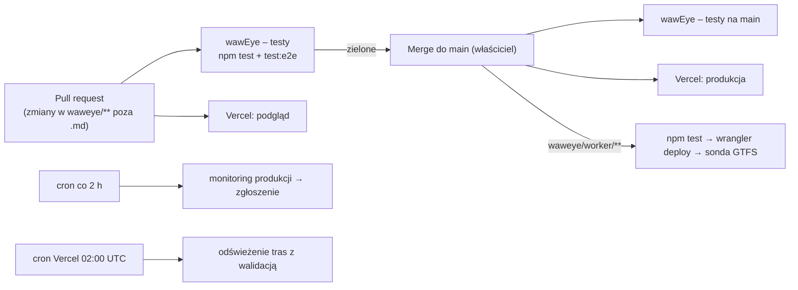

# wawEye – testy i zapewnienie jakości

Opis wszystkich testów i kontroli jakości w projekcie wawEye: co jest testowane, jak i kiedy testy się uruchamiają, gdzie trafiają wyniki i jak klasyfikuje się błędy. Dokument jest przeznaczony dla audytora oraz dla nowych osób w zespole. Na końcu jest szacunek ról i godzin dla klasycznego zespołu (bez AI). Plan usunięcia luk z §11: `PLAN_NAPRAWCZY_TESTOW.md`.

Stan na 2026-10-10 (commit `0f18edb` na `main`). Liczby testów pochodzą z uruchomienia obu zestawów tego dnia; statystyki przebiegów pochodzą z historii GitHub Actions repozytorium `pacy2u/waweye`.

## Spis treści

1. [Podsumowanie](#1-podsumowanie)
2. [Piramida testów i klasyfikacja](#2-piramida-testów-i-klasyfikacja)
3. [Testy automatyczne](#3-testy-automatyczne)
4. [Kontrole danych](#4-kontrole-danych)
5. [Monitoring produkcji i kontrole po wdrożeniu](#5-monitoring-produkcji-i-kontrole-po-wdrożeniu)
6. [Testy ręczne](#6-testy-ręczne)
7. [Kiedy co się uruchamia (CI/CD)](#7-kiedy-co-się-uruchamia-cicd)
8. [Raportowanie wyników i obsługa błędów](#8-raportowanie-wyników-i-obsługa-błędów)
9. [Jak uruchomić testy lokalnie](#9-jak-uruchomić-testy-lokalnie)
10. [Zasady dla nowych osób: pisanie testów](#10-zasady-dla-nowych-osób-pisanie-testów)
11. [Luki i ryzyka (dla audytora)](#11-luki-i-ryzyka-dla-audytora)
12. [Szacunek ról i godzin bez AI](#12-szacunek-ról-i-godzin-bez-ai)

---

## 1. Podsumowanie

| Rodzaj | Narzędzie | Liczba | Czas | Uruchamianie | Wynik 2026-10-10 |
|---|---|---|---|---|---|
| Jednostkowe i integracyjne (z atrapami sieci) | `node --test` (Node ≥ 18, w CI Node 22) | 128 testów w 6 plikach | < 1 s | każdy PR, push do `main`, przed wdrożeniem Workera | 128/128 |
| E2E w przeglądarce (dane MOCK) | Playwright (`playwright-core`) + Chromium | 112 sprawdzeń (50 kroków × 2 ekrany + 12 scenariuszy awarii i lokalizacji) | ok. 2 min | każdy PR, push do `main` | 112/112 |
| Kontrola jakości danych w repo | testy „committed … is plausible” + walidacja w skryptach | 3 testy + bramki w 3 skryptach | sekundy | z testami jednostkowymi i przy generowaniu danych | zielone |
| Monitoring produkcji (smoke test na żywo) | `scripts/check-production.js` | 4–5 sprawdzeń × 2 domeny | 1–3 min | cron co 2 h (w praktyce rzadziej, patrz §11) | 17/25 przebiegów zielonych |
| Kontrole po operacjach infrastruktury | `check-production.js`, `cloudflare-ops.js test-workera`, `test-gtfs` | – | – | po operacjach Vercel/Cloudflare | – |
| Testy eksploracyjne | ręcznie + Playwright, raport | 1 sesja (2026-10-02), 10 zgłoszeń | – | jednorazowo | 9 naprawionych, 1 częściowo |
| Przegląd kodu | pull request do `main`, merge przez właściciela | – | – | każda zmiana | – |

Historia CI (workflow „wawEye – testy”, wszystkie 68 przebiegów do 2026-10-10): 62 zielone (91%), 6 czerwonych – wszystkie na gałęziach PR, żaden na `main`.

---

## 2. Piramida testów i klasyfikacja

```
              ┌───────────────────────────┐
              │ Monitoring produkcji      │  prawdziwe API Warszawy, Vercel, Cloudflare
              │ (smoke na żywo, co 2 h)   │
           ┌──┴───────────────────────────┴──┐
           │ E2E w przeglądarce (112)        │  cała aplikacja, dane MOCK, desktop + telefon
        ┌──┴─────────────────────────────────┴──┐
        │ Jednostkowe / integracyjne (128)      │  logika, handlery API, Worker, skrypty
        │ + kontrole jakości danych             │  operacji i danych, z atrapą fetch
        └───────────────────────────────────────┘
   obok: testy eksploracyjne (ręczne), podglądy Vercel, przegląd PR
```

### Klasyfikacja według poziomu

| Poziom | Co obejmuje | Gdzie |
|---|---|---|
| Jednostkowy | czyste funkcje: normalizacja rekordów API, czas warszawski (lato/zima), geometria tras, prognoza ruchu, łączenie dróg OSM, przeliczenie na PL-2000 | `test/*.test.js` |
| Integracyjny (komponentowy) | handlery HTTP (`lib/handler.js`), Worker Cloudflare wywołany tak jak przez Cloudflare (`request, env, ctx`), skrypty operacji Vercel/Cloudflare na symulowanym API, pełny potok GTFS na małym pliku ZIP | `test/unit.test.js`, `test/operacje.test.js`, `test/trasy.test.js` |
| Systemowy (E2E) | cała aplikacja w Chromium: serwer `dev-server.js` z `MOCK=1`, kliknięcia, panele, warstwy, lokalizacja, timelapse, strona „O serwisie” | `test/e2e.js` |
| Akceptacyjny / smoke na produkcji | czy produkcja zwraca prawdziwe dane i czy pojazdy łączą się ze zbiorem taboru | `scripts/check-production.js` |
| Eksploracyjny | swobodne testy z analizą kodu i zapytaniami do API | `RAPORT_TESTOW_EKSPLORACYJNYCH.md` |

### Klasyfikacja według charakterystyki jakości (ISO/IEC 25010)

| Charakterystyka | Pokrycie | Przykłady testów |
|---|---|---|
| Przydatność funkcjonalna | wysokie | wszystkie funkcje użytkownika mają kroki E2E; każdy zbiór danych ma test normalizacji na rekordzie z dokumentacji |
| Niezawodność / odporność na błędy | wysokie | awarie każdego API osobno (502, 404, 522), ponowienie po błędzie sieci, brak ponowienia przy timeoucie, częściowe dane, „pojazdy zostają widoczne” |
| Bezpieczeństwo | częściowe | klucz API nigdy nie wycieka w odpowiedzi; Worker odrzuca brak sekretu (403); 400/405 dla złych parametrów i metod; klucze `__proto__` nie są zasobami; sekrety drukowane nigdy w logach operacji |
| Kompatybilność | częściowe | tylko Chromium; dwa rozmiary ekranu (1280×800, 390×780 dotyk) |
| Użyteczność | częściowe | brak poziomego przewijania, `aria-pressed`/`aria-expanded` na przyciskach; brak testów czytnika ekranu i klawiatury |
| Wydajność | brak testów | jedynie czasy odpowiedzi w raporcie monitoringu i test, że ukryta karta nie odpytuje API |
| Utrzymywalność | brak narzędzi | brak lintera, formatera, pomiaru pokrycia |
| Przenaszalność | n/d | – |

### Klasyfikacja według sposobu wykonania

- **Automatyczne, blokujące merge (procesowo):** jednostkowe + E2E w workflow „wawEye – testy”.
- **Automatyczne, blokujące wdrożenie:** testy jednostkowe przed `wrangler deploy` Workera; walidacja danych w skryptach `metro.js`, `strefy.js`, `trasy.js` i w odświeżaniu tras (zła paczka nie zostaje zapisana).
- **Automatyczne, po wdrożeniu (wykrywanie):** monitoring co 2 h, kontrola po operacjach Vercel, sonda GTFS po wdrożeniu Workera (tylko raport).
- **Ręczne:** testy eksploracyjne, oglądanie podglądów Vercel, przegląd PR, ręczne uruchamianie workflowów kontrolnych.

---

## 3. Testy automatyczne

### 3.1. Testy jednostkowe i integracyjne (`npm test`)

Uruchamia `node --test` na sześciu plikach. Nie ma zależności testowych poza Node.js. Sieć jest zawsze atrapą: funkcje przyjmują `fetchImpl`, `sleep`, `now` jako zależności (wstrzykiwanie zależności), dzięki czemu testy są deterministyczne i nie łączą się z internetem.

| Plik | Testy | Obszar |
|---|---|---|
| `test/unit.test.js` | 60 | Klient API Warszawy (`lib/warsaw.js`): normalizacja pojazdów, parkingów, utrudnień, taboru, sportu, wydarzeń; odrzucanie danych przestarzałych i spoza obszaru; tryb bezpośredni i przez Workera; ponowienia i timeouty; czytelne komunikaty błędów. Handlery HTTP (`lib/handler.js`): MOCK, 400/405/502, cache. Worker Cloudflare (`worker/index.js`): sekret, zasoby, fallback autoryzacji, magazyn geokodów KV, strumień GTFS. Geokodowanie (`lib/geocoding.js`): limit 1 zapytanie/1,1 s do Nominatim, pamięć podręczna, praca w tle. Ocena zdrowia produkcji (`check-production.js` → `evaluate`). |
| `test/operacje.test.js` | 22 | Skrypty `vercel-ops.js` i `cloudflare-ops.js` na symulowanym API Vercel/Cloudflare: idempotentność, blokady przed usunięciem Workera używanego przez produkcję, nieujawnianie wartości sekretów, zachowanie przy nieudanym buildzie. |
| `test/trasy.test.js` | 21 | Potok GTFS ZTM (`scripts/trasy.js`, `lib/zip.js`): parsowanie CSV, wybór wariantów, ZIP (stored/deflate/ZIP64), walidacja przed zapisem, odświeżanie magazynu tras w Workerze, rozkład godzinowy dla timelapse. Wybór kierunku trasy w przeglądarce (`public/trasa.js`). |
| `test/strefy.test.js` | 10 | Granica Strefy Czystego Transportu z OSM (`scripts/strefy.js`): sklejanie dróg w pierścień, wielokąty z dziurami, fallback Overpass → OSM API, warstwy WMS, przeliczenie na EPSG:2178 zgodne z proj4. |
| `test/metro.test.js` | 9 | Warstwa metra (`scripts/metro.js`): łączenie odcinków, przypisanie stacji do linii, walidacja (2 linie, liczba stacji, Świętokrzyska w centrum), fallback serwerów Overpass. |
| `test/prognoza.test.js` | 6 | Prognoza ruchu dla timelapse (`public/prognoza.js`): ruch po trasie ze średnią prędkością, postój na pętli, odjazdy wg rozkładu, zjazd do zajezdni. |

Dane testowe: rekordy przepisane z dokumentacji API (dane.um.warszawa.pl), mały plik `test/dane/gtfs-mini.zip` (6 plików GTFS, 1,2 KB) oraz symulowane odpowiedzi API Vercel i Cloudflare zdefiniowane w plikach testów.

### 3.2. Testy E2E w przeglądarce (`npm run test:e2e`)

Plik `test/e2e.js`. Uruchamia lokalny serwer (`dev-server.js`) z danymi symulowanymi (`MOCK=1`, `lib/mock.js`) i Chromium przez `playwright-core`. Kafelki WMS miasta są podmieniane na przezroczysty piksel, więc test nie wychodzi do internetu. Każdy krok wypisuje `ok - <nazwa>` albo `FAIL - <nazwa>` i przerywa przebieg.

**Część 1: 50 kroków powtarzanych na dwóch ekranach** – desktop 1280×800 i telefon 390×780 (dotyk, `deviceScaleFactor: 2`):

| Obszar | Co sprawdza |
|---|---|
| Pojazdy | ładowanie i rysowanie, płynny ruch między odczytami GPS, zoom, wybór i wyróżnienie, panel z danymi taboru, zaznaczenie przetrwa odświeżenie, śledzenie, trasa linii z przystankami, odznaczanie (×, klik w mapę), filtr typu, wyszukiwanie linii, etykiety przy dużym zoomie, licznik zgodny z widocznymi pojazdami |
| Moja lokalizacja | znajdowanie i niebieska kropka, podążanie i jego przerwanie przeciągnięciem, zoom z zachowaniem środka, kompas (obrót krótszą drogą), klikalność pojazdów pod kropką, przycisk nad otwartym panelem, wzajemne wykluczanie ze śledzeniem pojazdu |
| Panele | zwijanie do paska (zapamiętane), wzajemne wykluczanie paneli |
| Warstwy | parkingi, strefa płatnego parkowania (SPPN), Strefa Czystego Transportu (pod pojazdami, pojazdy dalej klikalne), panele zasad stref, metro M1/M2 ze stacjami, utrudnienia (punkty i linie), Sport, DziejeSię, wspólny filtr „Kiedy”, wyszukiwanie bez rozróżniania wielkości liter i polskich znaków |
| Timelapse | prognoza ruchu po trasach, tempo ×0–×1000, suwak czasu 24 h, powrót do czasu rzeczywistego; wariant z rozkładem (zjazd linii dziennych, wyjazd nocnych) |
| Zachowanie techniczne | ukryta karta nie odpytuje API, brak poziomego przewijania, brak błędów JS |
| Strona „O serwisie” | link z logo, film czeka na kliknięcie, pliki multimedialne się ładują, format filmu wg urządzenia (16:9 / 9:16), powrót do mapy |

**Część 2: 12 scenariuszy awarii i lokalizacji (jednorazowo):** brak klucza API → baner błędu; awaria osobno parkingów, sportu (z ponowieniem po minucie), utrudnień, danych metra, danych SCT – zawsze z komunikatem i z pojazdami widocznymi dalej; odmowa dostępu do lokalizacji; lokalizacja poza Warszawą (Kraków); zgoda udzielona wcześniej; brak błędów JS.

Przy porażce w CI zrzuty ekranu `waweye-*.png` trafiają do artefaktu `zrzuty-ekranu-e2e` (przechowywany 7 dni).

### 3.3. Testy przed wdrożeniem Workera

Workflow „wawEye – wdrożenie Workera Cloudflare” uruchamia `npm ci && npm test` przed `wrangler deploy`. Czerwone testy zatrzymują wdrożenie. Po wdrożeniu (30 s opóźnienia na propagację) sonda `test-gtfs` sprawdza, czy Worker pobiera GTFS ZTM; jej wynik jest tylko raportem (`continue-on-error`).

---

## 4. Kontrole danych

Aplikacja korzysta z danych statycznych generowanych skryptami. Każdy skrypt ma bramkę jakości: gdy dane nie przejdą walidacji, przebieg kończy się błędem, a stary plik zostaje.

| Dane | Skrypt | Walidacja przed zapisem | Test na danych w repo |
|---|---|---|---|
| Metro M1/M2 (`public/data/metro.geojson`) | `scripts/metro.js` (workflow `waweye-dane-metra.yml`) | dokładnie 2 linie, liczba stacji zgodna ze stanem z października 2026, Świętokrzyska w centrum, wszystko w granicach Warszawy | `committed metro layer is plausible` |
| Granica SCT (`public/data/strefa-czystego-transportu.geojson`) | `scripts/strefy.js` (workflow `waweye-dane-stref.yml`) | zamknięty pierścień, wiarygodna powierzchnia i położenie | `committed SCT boundary is plausible` |
| Trasy linii (`public/data/trasy/`, magazyn KV Workera) | `scripts/trasy.js`, cron Vercel `/api/odswiez-trasy` (02:00 UTC = 04:00 czasu warszawskiego latem) | wystarczająca liczba linii, obecność znanych linii, użyteczne warianty, ważność rozkładu; dla rozkładu godzinowego: liczba dni i kursów, linia N25 w nocy | `committed route files are plausible` |

Świeżość magazynu tras sprawdza też monitoring produkcji (wiersz „Trasy linii”, alarm po 48 h bez odświeżenia).

---

## 5. Monitoring produkcji i kontrole po wdrożeniu

### 5.1. `scripts/check-production.js`

Smoke test na żywym systemie. Odpytuje równolegle `/api/vehicles`, `/api/parking`, `/api/incidents`, `/api/fleet` i `/api/trasa?meta=1` (timeout 60 s) i ocenia:

| Sprawdzenie | Błąd, gdy |
|---|---|
| Pojazdy | HTTP ≠ 200, źródło inne niż `live` (np. MOCK na produkcji), 0 pojazdów, częściowe błędy |
| Parkingi | HTTP ≠ 200, brak listy, 0 parkingów |
| Utrudnienia | HTTP ≠ 200, brak listy |
| Tabor | pusty zbiór; mniej niż 90% pojazdów na żywo (autobusy, tramwaje osobno) ma wpis w zbiorze taboru; typ z mniej niż 20 pojazdami nie jest oceniany (np. tramwaje w nocy) |
| Trasy linii (opcjonalnie) | brak daty odświeżenia, odświeżenie starsze niż 48 h, rozkład wygasły |

Przy błędzie skrypt czeka 30 s i powtarza kontrolę raz, żeby pojedyncze zerwane połączenie nie wywołało alarmu. Wynik to tabela Markdown (OK/BŁĄD + szczegóły, godzina warszawska) i kod wyjścia 0/1. Logika oceny (`evaluate`) jest pokryta testami jednostkowymi.

### 5.2. Gdzie działa

| Workflow | Kiedy | Co robi z wynikiem |
|---|---|---|
| wawEye – monitoring produkcji | cron `7 */2 * * *` (UTC) i ręcznie; obie domeny: `waweye.vercel.app`, `pasibus.vercel.app` | przy błędzie otwiera jedno zgłoszenie „[monitoring] wawEye nie działa poprawnie” (GitHub wysyła e-mail właścicielowi), przy pierwszej udanej kontroli zamyka je z komentarzem |
| wawEye – kontrola adresu | ręcznie, dowolny adres `https://` | raport w podsumowaniu przebiegu, bez zgłoszeń |
| wawEye – operacje Vercel | po operacjach wdrażających i dodaniu domeny | kontrola dotkniętych domen; błąd = czerwony przebieg |
| wawEye – operacje Cloudflare | `test-workera`, `test-gtfs` na żądanie | sprawdza wszystkie zasoby Workera z sekretem i odmowę 403 bez sekretu |

Historia (2026-10-04 – 2026-10-10): 25 przebiegów monitoringu, 17 zielonych, 8 czerwonych; 6 zgłoszeń „[monitoring]” założonych i zamkniętych automatycznie (#26, #36, #37, #61, #64, #67). Przyczyny nie są opisane w zgłoszeniach; analiza ich treści (wszystkie 5 to chwilowy błąd 522 API miasta przez Workera, nigdy cała aplikacja) jest w `PLAN_NAPRAWCZY_TESTOW.md` §1.

### 5.3. Sygnały w samej aplikacji

Pasek statusu pokazuje częściowe błędy źródeł („parkingi: brak danych (HTTP 403)”), wiek danych i oznaczenie „dane testowe” w trybie MOCK. Pojazdy z danymi starszymi niż 3 min są przyciemnione. Aplikacja nie zbiera analityki użytkowników – to decyzja projektowa.

---

## 6. Testy ręczne

| Rodzaj | Jak | Ślad |
|---|---|---|
| Testy eksploracyjne | sesja 2026-10-02 na `pasibus.vercel.app`: desktop 1280×800, telefon 360×640, poziomo 640×360, analiza kodu, zapytania do API (metody HTTP, złe parametry, XSS w wyszukiwarce) | `RAPORT_TESTOW_EKSPLORACYJNYCH.md`: 10 zgłoszeń z wagą, lista „co działa”, „czego nie sprawdzono” i status poprawek |
| Podgląd zmian | każdy PR dostaje wdrożenie podglądowe Vercel; nowego Workera sprawdza się przez `operacje Vercel → przelacz-podglady` (podgląd z nowym Workerem, produkcja bez zmian) | komentarze w PR, podsumowania przebiegów Actions |
| Przegląd kodu | PR do `main`, merge wykonuje właściciel po zielonych testach | historia PR na GitHubie (70 PR do 2026-10-10) |
| Sprawdzenie po wdrożeniu | ręczne uruchomienie „kontrola adresu” albo obejrzenie aplikacji | podsumowanie przebiegu |

Nie ma formalnego planu testów ręcznych, scenariuszy w narzędziu do zarządzania testami ani macierzy śledzenia wymagań. Rolę specyfikacji pełnią nazwy kroków E2E (opisują oczekiwane zachowanie) i `CONTEXT.md`.

---

## 7. Kiedy co się uruchamia (CI/CD)



| Zdarzenie | Testy |
|---|---|
| PR ze zmianą kodu, workflowów lub danych | jednostkowe + E2E |
| PR tylko z plikami `.md` | brak (oszczędność minut Actions) |
| push do `main` | jednostkowe + E2E (równolegle z wdrożeniem produkcji na Vercel) |
| push do `main` w `waweye/worker/**` | dodatkowo jednostkowe przed wdrożeniem Workera |
| push skryptu danych na gałęzi innej niż `main` | generowanie danych z walidacją |
| co 2 h | monitoring produkcji |
| codziennie 02:00 UTC | odświeżenie tras z walidacją (Vercel) |

Środowisko CI: `ubuntu-latest`, Node 22, `npm ci` z cache, Google Chrome preinstalowany na runnerze, limit 10 min na zadanie. Równoległe przebiegi tej samej gałęzi są anulowane (`concurrency`).

---

## 8. Raportowanie wyników i obsługa błędów

| Źródło | Format | Gdzie |
|---|---|---|
| `npm test` | TAP (`ok N - nazwa`, podsumowanie `# pass/# fail`) | konsola, log zadania Actions |
| `npm run test:e2e` | `ok - nazwa` / `FAIL - nazwa` + stos błędu, na końcu `N checks passed` | konsola, log zadania; zrzuty ekranu jako artefakt przy porażce |
| Monitoring | tabela Markdown OK/BŁĄD | podsumowanie przebiegu; treść zgłoszenia GitHub przy awarii |
| Operacje i dane | raport Markdown | podsumowanie przebiegu (`GITHUB_STEP_SUMMARY`) |
| Testy eksploracyjne | tabela zgłoszeń z wagą i statusem | `RAPORT_TESTOW_EKSPLORACYJNYCH.md` |
| Status PR | zielony/czerwony check „wawEye – testy” | strona PR |

### Klasyfikacja błędów

W raporcie eksploracyjnym stosowana jest skala wagi:

| Waga | Znaczenie | Przykład z raportu |
|---|---|---|
| Krytyczna | aplikacja nie działa albo pokazuje błędne dane | (brak w raporcie; w praktyce: alarm monitoringu) |
| Wysoka | kluczowa funkcja niedostępna dla części użytkowników | (brak w raporcie) |
| Średnia | funkcja utrudniona, jest obejście | pasek górny nie mieści się na ekranie 360 px |
| Niska | kosmetyka, drobna niedogodność | brak favicony, „– ?” zamiast „bez daty zakończenia” |
| Info | obserwacja bez wpływu na użytkownika | 7 z 1872 pojazdów z danymi starszymi niż 180 s |

Poziomy „Krytyczna” i „Wysoka” są uzupełnieniem tego dokumentu – w repozytorium do tej pory użyto tylko Średnia/Niska/Info. Alarm monitoringu traktuje się jak błąd krytyczny produkcji. Statusy poprawek: Naprawione / Częściowo / Nie zmieniono (z uzasadnieniem). Każda poprawka powinna mieć test, który by ją wykrył (przykład: test 400/405 dodany po zgłoszeniu #9).

---

## 9. Jak uruchomić testy lokalnie

```bash
cd waweye
npm ci
npm test                   # jednostkowe, < 1 s, bez internetu
npm run test:e2e           # Chromium, ok. 2 min, bez internetu
node scripts/check-production.js https://waweye.vercel.app   # produkcja (wymaga dostępu do internetu)
```

E2E szuka Chromium w `CHROME_PATH`, potem w `PLAYWRIGHT_BROWSERS_PATH` (domyślnie `/opt/pw-browsers`). Zrzuty ekranu zapisuje do katalogu `SHOTS` (domyślnie `/tmp`). Aplikację na danych symulowanych uruchamia `MOCK=1 npm start` (http://localhost:3000).

---

## 10. Zasady dla nowych osób: pisanie testów

- **Nowy zbiór danych** = endpoint w `lib/warsaw.js` + `lib/handler.js` + `api/<nazwa>.js` + `dev-server.js` + wpis w `RESOURCES` w `worker/index.js` + dane w `lib/mock.js` + test jednostkowy z rekordem z dokumentacji API + krok E2E na MOCK + krok awarii („brak danych”, pojazdy zostają widoczne).
- **Bez sieci w testach.** Przekazuj `fetchImpl`, `sleep`, `now` jako zależności; nie wołaj prawdziwych API.
- **Każda funkcja widoczna dla użytkownika ma krok E2E** na obu ekranach. Nazwa kroku opisuje oczekiwane zachowanie po angielsku, pełnym zdaniem.
- **Dane MOCK się ruszają.** Testy klikające w pojazdy muszą zamrozić dane (np. `document.hidden = true` i poczekać, aż żaden znacznik nie jest w ruchu), inaczej poll co 10 s przesuwa pojazd spod kursora.
- **Sekrety:** test powinien sprawdzać, że wartość sekretu nie pojawia się w odpowiedzi ani w logu.
- **Dane statyczne:** zmiana skryptu danych wymaga walidacji przed zapisem i testu na pliku w repo.
- **Błąd z produkcji lub z testów ręcznych:** najpierw test, który go odtwarza, potem poprawka.
- **Przed PR:** `npm test && npm run test:e2e` lokalnie; PR ma opisową nazwę gałęzi.

---

## 11. Luki i ryzyka (dla audytora)

Ocena pewności: **[Pewne]** – sprawdzone w repozytorium lub historii Actions; **[Prawdopodobne]** – wniosek z konfiguracji; **[Niezweryfikowane]** – poza zasięgiem tej analizy.

| # | Luka | Ryzyko | Rekomendacja | Pewność |
|---|---|---|---|---|
| 1 | Monitoring ma działać co 2 h, a w 6,5 dnia wykonał 25 przebiegów zamiast ok. 80 (średnio co ok. 6,5 h). Harmonogramy GitHub Actions są opóźniane lub pomijane. | awaria produkcji może trwać kilka godzin bez alarmu | zewnętrzny monitor dostępności (np. darmowy UptimeRobot, Cloudflare Health Checks) jako drugi kanał | [Pewne] |
| 2 | 8 z 25 przebiegów monitoringu było czerwonych; zgłoszenia zamykają się same bez opisu przyczyny. Analiza 5 zgłoszeń (`PLAN_NAPRAWCZY_TESTOW.md` §1): za każdym razem chwilowy błąd 522 API miasta dla części zbiorów, drugi adres chwilę później działał. | monitoring nie odróżnia krótkiej awarii dostawcy od awarii aplikacji; alarmy tracą wartość | kategorie przyczyn i alarm dopiero po dwóch kolejnych błędach dostawcy (plan, zadanie A4) | [Pewne] |
| 3 | Produkcja Vercel wdraża się po merge do `main` równolegle z testami na `main`, nie po nich. Bramką są zielone testy na PR i decyzja właściciela. | zmiana zielona na PR, ale czerwona po scaleniu z nowszym `main`, trafi na produkcję | wymagane checki i „branch must be up to date” w ochronie gałęzi | [Prawdopodobne] |
| 4 | Ochrona gałęzi `main` (wymagane checki, wymagany przegląd) nie jest widoczna w repozytorium. | merge z czerwonymi testami jest technicznie możliwy | sprawdzić i włączyć w ustawieniach repozytorium | [Niezweryfikowane] |
| 5 | Brak pomiaru pokrycia kodu (`c8`, `--experimental-test-coverage`). | nie da się wykazać pokrycia liczbowo | dodać raport pokrycia do CI (Node 22 ma go wbudowanego) | [Pewne] |
| 6 | Brak lintera, formatera i analizy statycznej. | błędy wykrywalne statycznie trafiają do testów lub produkcji | ESLint + Prettier w CI | [Pewne] |
| 7 | Brak skanowania zależności i SAST w repozytorium (brak `dependabot.yml`, CodeQL). Zależności są minimalne (Leaflet 1.9.4 w `public/vendor`, `playwright-core` tylko testowo). | niska podatność na łańcuch dostaw, ale brak dowodu kontroli | Dependabot + CodeQL (darmowe) | [Pewne] co do repo, [Niezweryfikowane] co do ustawień GitHub |
| 8 | E2E działa wyłącznie na danych MOCK; zgodność z prawdziwym API sprawdza dopiero monitoring po wdrożeniu. | zmiana formatu API miasta wykrywana na produkcji, nie przed nią | okresowy test kontraktowy na prawdziwym API (utrudnione: API miasta nie odpowiada z chmur, patrz `ARCHITEKTURA.md` §10) | [Pewne] |
| 9 | Tylko Chromium; brak Safari/iOS i Firefoksa. | błędy na iPhone'ach (duża część użytkowników mobilnych) niewykryte | dodać WebKit i Firefox w Playwright albo ręczny test na iOS przed większym wydaniem | [Pewne] |
| 10 | Brak testów dostępności (czytnik ekranu, klawiatura; znaczniki mapy nie są dostępne z klawiatury – decyzja projektowa). | niezgodność z WCAG 2.1 (istotne, jeśli serwis miałby trafić do sektora publicznego) | axe-core w E2E, decyzja o zakresie WCAG | [Pewne] |
| 11 | Brak testów wydajności i obciążenia. | nieznane zachowanie przy ruchu (limity Vercel/Cloudflare, limit Nominatim) | prosty test obciążenia API przed promocją serwisu | [Pewne] |
| 12 | Testy ręczne nieformalne: jedna sesja eksploracyjna, brak planu testów, brak macierzy wymagania–testy. | słaby ślad audytowy dla testów ręcznych | lista kontrolna regresji ręcznej przed wydaniem (iOS, poziomo, wolna sieć) | [Pewne] |
| 13 | Proces jest jednoosobowy: ten sam właściciel zatwierdza i scala zmiany, w dużej części przygotowane przez Claude. | brak rozdzielenia obowiązków (autor/recenzent) | przy zespole: wymagany przegląd drugiej osoby | [Pewne] |

Mocne strony: testy są szybkie, deterministyczne i nie wymagają sieci; każda awaria źródła danych ma test odporności; dane statyczne mają bramki jakości; operacje infrastruktury są skryptami z testami zamiast klikania w panelach; monitoring zakłada i zamyka zgłoszenia automatycznie; CI nie miało czerwonego przebiegu na `main`.

---

## 12. Szacunek ról i godzin bez AI

**To jest szacunek eksperta, nie pomiar.** Większość liczb poniżej to [Prawdopodobne] lub [Szacunek]; podstawą jest wielkość kodu i liczba integracji, a nie dane historyczne zespołu.

### 12.1. Skala systemu (podstawa szacunku)

| Element | Wielkość |
|---|---|
| Kod aplikacji (front, API, Worker, biblioteki, skrypty) | ok. 4 300 linii JS |
| Kod testów | ok. 2 700 linii JS (128 testów + 112 sprawdzeń E2E) |
| Workflowy CI/CD | 8 plików |
| Dokumentacja techniczna | ok. 1 400 linii Markdown |
| Integracje zewnętrzne | 7 zbiorów API Warszawy, GTFS ZTM, OpenStreetMap (Overpass, OSM API), Nominatim, WMS miasta, Vercel (funkcje, cron), Cloudflare (Worker, KV) |
| Funkcje użytkownika | ok. 11 (pojazdy na żywo, trasa linii, lokalizacja z kompasem, parkingi, utrudnienia, strefy SPPN/SCT, metro, Sport, DziejeSię, wyszukiwanie, timelapse) |

Obecny projekt powstał w 9 dni (2026-10-02 – 2026-10-10, 143 commity, 70 PR) z intensywnym użyciem AI. To tempo nie jest punktem odniesienia dla zespołu klasycznego.

### 12.2. Role w zespole klasycznym

| Rola | Zakres w wawEye |
|---|---|
| Product Owner / analityk | priorytety, kontakt z dostawcami danych (UM Warszawa, ZTM), licencje danych, akceptacja |
| Frontend developer | mapa Leaflet, panele, warstwy, timelapse, wersja mobilna |
| Backend / integration developer | funkcje Vercel, Worker Cloudflare, klient API Warszawy, potok GTFS, geokodowanie |
| QA engineer (manual + automatyzacja) | utrzymanie Playwright i testów jednostkowych, testy regresji i eksploracyjne, testy na iOS |
| DevOps / SRE | GitHub Actions, Vercel, Cloudflare, sekrety, monitoring, reakcja na alarmy |
| UX/UI designer | układ mobilny, ikony, dostępność |
| Opcjonalnie: tech writer, audytor bezpieczeństwa (raz w roku) | dokumentacja, przegląd bezpieczeństwa |

### 12.3. Odtworzenie obecnej wersji od zera (jednorazowo)

| Obszar | Osobodni | Godziny |
|---|---|---|
| Analiza, rozpoznanie API i licencji, planowanie | 12–18 | 96–144 |
| UX/UI (mapa, panele, mobile) | 8–12 | 64–96 |
| Backend: API, Worker, 7 zbiorów, geokodowanie, KV | 25–35 | 200–280 |
| Frontend: mapa, warstwy, lokalizacja, timelapse, „O serwisie” | 45–60 | 360–480 |
| Potoki danych: GTFS, metro, strefy, odświeżanie tras | 18–25 | 144–200 |
| DevOps: CI/CD, operacje Vercel/Cloudflare, monitoring | 12–18 | 96–144 |
| Testy automatyczne (jednostkowe + E2E) i testy ręczne | 30–40 | 240–320 |
| Dokumentacja techniczna i dla użytkownika | 6–10 | 48–80 |
| **Razem** | **156–218** | **ok. 1 250–1 750 h** |

Przy zespole 3–4 osób to ok. 3–4 miesiące kalendarzowe. [Szacunek] Dla porównania: 4 300 linii kodu z testami na 1 250–1 750 h daje 2,5–3,5 linii na godzinę łącznie z analizą, testami i dokumentacją, co mieści się w typowych wartościach dla małych projektów z wieloma integracjami.

### 12.4. Utrzymanie (bez nowych funkcji), miesięcznie

| Czynność | Godziny / mies. | Rola |
|---|---|---|
| Reakcja na alarmy monitoringu, analiza przyczyn | 10–20 | DevOps, backend |
| Zmiany po stronie API miasta i GTFS (format, autoryzacja, dostępność – przykład: migracja na nowe API z nagłówkiem `Authorization`) | 8–16 | backend |
| Naprawa błędów zgłoszonych przez użytkowników | 10–20 | frontend, backend |
| Aktualizacje zależności i platform (Node, Leaflet, Playwright, Actions, wrangler, Vercel) | 4–8 | DevOps |
| Regresja: utrzymanie testów, test ręczny przed wydaniem (iOS, poziomo) | 8–16 | QA |
| Bezpieczeństwo: rotacja sekretów, przegląd uprawnień tokenów | 2–4 | DevOps |
| Aktualizacja danych statycznych (metro, strefy) i dokumentacji | 2–4 | backend, tech writer |
| Koordynacja, priorytety | 4–8 | PO |
| **Razem** | **48–96 h** (ok. 0,3–0,6 etatu) | |

### 12.5. Utrzymanie i rozwój, miesięcznie

Scenariusz „średni rozwój”: utrzymanie z §12.4 plus ok. 1–2 funkcje miesięcznie z roadmapy (`ROADMAPA.md`), np. nowa warstwa danych z testami.

| Rola | Etat | Godziny / mies. (160 h = 1 etat) |
|---|---|---|
| Product Owner / analityk | 0,25 | 40 |
| Frontend developer | 1,0 | 160 |
| Backend / integration developer | 0,5 | 80 |
| QA engineer | 0,5 | 80 |
| DevOps / SRE | 0,2 | 32 |
| UX/UI designer | 0,2 | 32 |
| **Razem** | **2,65 etatu** | **ok. 425 h / mies. (ok. 5 100 h / rok)** |

| Scenariusz | Etaty | Godziny / rok |
|---|---|---|
| Tylko utrzymanie | 0,3–0,6 | 580–1 150 |
| Utrzymanie + średni rozwój | ok. 2,65 | ok. 5 100 |
| Rozwój w tempie z października 2026 (kilka funkcji tygodniowo) | 5–7 | 9 600–13 400 |

[Szacunek] Największa niepewność dotyczy kosztu reakcji na zmiany API miasta i alarmy: w pierwszym tygodniu monitoringu było 8 czerwonych przebiegów na 25, ale bez analizy przyczyn nie wiadomo, ile z nich wymagało pracy człowieka.
